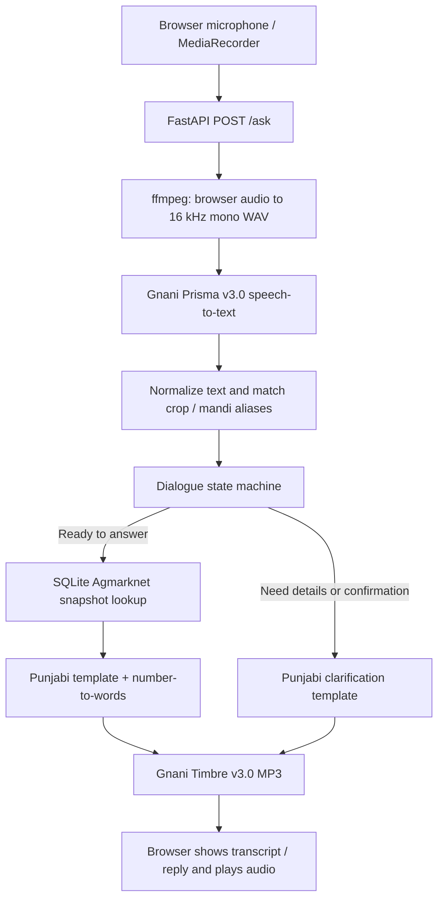

# Mandi Vaaz

**A voice-first mandi-price assistant for Punjab. Ask in Punjabi or Punglish and hear a Punjabi response.**

Mandi Vaaz is a prototype web application that lets a user ask about a crop's mandi (market) price using speech. It combines Gnani Prisma speech-to-text, a lightweight rule-based parser and dialogue state machine, a local Agmarknet price snapshot, fixed Punjabi response templates, and Gnani Timbre text-to-speech.

> [!IMPORTANT]
> **Mandi Vaaz is not a live-price service.** The bundled SQLite database is a historical Agmarknet snapshot. Its 19,959 rows span **1 November 2025 to 26 May 2026**, but records for the three enabled crops are concentrated around March and early April 2026. The application reports the record date and warns when a price is older than three days. Do not use the displayed values as today's market rates or as the sole basis for a trading decision.

## At a glance

| Area | Current implementation |
|---|---|
| Interface | Browser-based voice interface with transcript, reply text, audio playback and replay control |
| Main input styles | Punjabi (Gurmukhi) and Punglish (Punjabi grammar with English words) |
| Reply language | Punjabi, generated from fixed templates and spoken by Timbre v3.0 |
| Speech recognition | Prisma v3.0; default `paen_codemix_ctx` configuration (`pa-IN,en-IN`, `codemix`, topic and keyterms) |
| Understanding | Unicode normalization, alias tables, RapidFuzz matching and a Python state machine |
| Price source | Local SQLite snapshot ingested from Agmarknet via data.gov.in |
| Crops enabled for answers | Potato, onion and tomato |
| Markets recognised | Nine Punjab mandis; Barnala and Sangrur are deliberately marked unanswerable in the current agent |
| Backend | FastAPI |
| Response generation | Deterministic Punjabi templates; no LLM is used to invent or phrase prices |
| Public evaluation audio | 40 STT-feasibility clips and a separate 18-clip held-out set |

## Why Mandi Vaaz?

Market-price information is less useful when a farmer has to navigate a text-heavy interface or work around unfamiliar language. Mandi Vaaz explores a voice-first interaction: speak a crop and market question naturally, have the key details extracted, and hear a short answer in Punjabi. The project is deliberately narrow so that the speech, parsing, dialogue and data-lookup stages can be tested separately.

## Features

- **Voice input in the browser:** the page records a short audio clip using `MediaRecorder` and sends it to the backend.
- **Punjabi and Punglish recognition:** Prisma v3.0 is configured for Punjabi and English code-mixing. The alias tables include Gurmukhi, Roman and selected Devanagari spellings for crop and mandi names.
- **Crop and mandi extraction:** Unicode normalization, exact aliases and RapidFuzz similarity matching map variants and spelling errors to canonical IDs.
- **Dialogue handling:** the state machine asks for a missing crop or mandi, asks for confirmation when a match is weak, and refuses unsupported or unavailable requests rather than fabricating a price.
- **Historical price lookup:** parameterized SQLite queries select the most recent suitable record. If an eligible mandi has no exact record, the lookup can try a nearby mandi within 120 km and identify the substitute market in the reply.
- **Freshness disclosure:** replies state the record date and include a warning when the record is more than three days old. The app does not relabel old data as today's price.
- **Punjabi speech output:** fixed templates produce a short Punjabi response; the price and date numbers are converted to Punjabi words before Timbre v3.0 generates MP3 audio.
- **Comparison handling:** a comparison request can return up to two mandi results. The controller avoids silently answering only one market when a two-market comparison was requested but only one was recognised.
- **Session handling:** the backend keeps dialogue state per session, expires inactive sessions after 15 minutes, caps the store at 500 sessions, and limits concurrent Gnani calls by default.
- **Degraded responses:** when STT or the agent fails, the pipeline returns an error message; when TTS fails, it keeps the text response available without audio.

## Language support: what is and is not supported

| Capability | Status | Evidence and qualification |
|---|---|---|
| Punjabi speech input | **Implemented and evaluated** | The current default uses `pa-IN,en-IN` codemix. The 18-clip held-out evaluation contained nine Punjabi clips. |
| Punglish speech input | **Implemented and evaluated** | The 18-clip held-out evaluation contained nine Punglish clips; both styles were tested through the real STT-to-parser path. |
| Hindi-mixed input | **Experimental / partial** | An earlier 40-clip feasibility set included 12 Hindi-mixed clips. The candidate `pa-IN,hi-IN,en-IN` configuration scored 11/12 on that group, while the app's chosen `pa-IN,en-IN` contextual configuration scored 7/12. These are small feasibility results, not a dedicated Hindi release test. |
| Full Hindi conversation and Hindi spoken replies | **Not currently supported as an end-to-end mode** | The runtime STT configuration does not expose the `pa-IN,hi-IN,en-IN` test configuration, and the app's reply templates and TTS default are Punjabi (`pa-IN`). The 18-clip held-out evaluation did not include Hindi clips. |

**Recommended public wording:** “Punjabi and Punglish voice input with Punjabi spoken responses; limited experimental compatibility with Hindi-mixed input.” Avoid claiming full Hindi support until a Hindi runtime mode, Hindi response templates/TTS selection, and a separate Hindi test set have been implemented and evaluated.

## How it works



1. **Capture and transport:** the browser records audio and uploads it to FastAPI. The Gnani API key remains on the server.
2. **Audio conversion and transcription:** ffmpeg converts browser audio to 16 kHz mono WAV; Prisma v3.0 returns a transcript.
3. **Normalization and parsing:** text is normalized and crop/mandi names are matched against aliases. The parser returns canonical IDs, match scores, intent and status.
4. **Dialogue decision:** the state machine decides whether to clarify, confirm, answer or refuse.
5. **Price lookup:** a parameterized SQLite query retrieves the relevant historical record, or applies an eligible nearby-market fallback.
6. **Response and playback:** fixed Punjabi templates are filled with database values, numbers are rendered as Punjabi words, Timbre creates an MP3, and the browser displays and plays the result.

The controller is intentionally a small Python state machine—not an LLM agent or LangGraph workflow. Price facts come from the database, while fixed templates reduce the chance of a language model inventing a number.

## Current data scope

### Crops

The parser knows aliases for nine crops, but the agent only enables price answers for:

- Potato
- Onion
- Tomato

Wheat, cotton, mustard, moong, paddy and maize can be recognised as crop names but are not enabled for price answers in the current application. The database contains a few paddy and maize records, but the current `SUPPORTED_CROPS` allowlist is intentionally limited to the three vegetables above.

### Mandis

The parser recognises Ludhiana, Khanna, Bathinda, Jalandhar, Amritsar, Patiala, Moga, Sangrur and Barnala. **Barnala and Sangrur are explicitly marked unanswerable** in the current agent. For the other markets, exact crop-market coverage is uneven; if no exact record is available, the lookup may use a nearby mandi within the configured 120 km limit. The reply template is designed to name the substitute mandi.

### Snapshot characteristics

- Database: `data/mandi.db`
- Rows: **19,959**
- Overall date range: **2025-11-01 to 2026-05-26**
- Rows by month: November 2025: 2,240; December: 6,080; January 2026: 3,430; February: 3,294; March: 4,886; April: 18; May: 11
- Product records in the snapshot: potato 987, onion 1,089, tomato 780 (the application enables these three)
- Unit: rupees per quintal (100 kg)

The latest database row is not the same as fresh coverage for every crop-market pair. Most markets' latest records are around 31 March 2026, and some pairs have only a handful of records. The interface therefore labels the data as a snapshot and speaks the record date.

## Evaluation and observed performance

Mandi Vaaz includes two separate audio datasets. They serve different purposes and should not be mixed when reporting evaluation results.

### 1. STT feasibility dataset: 40 clips

The 40-clip dataset is used to compare Prisma STT configurations. It contains five speaker labels and three question groups:

| Question group | Clips | Description |
|---|---:|---|
| A | 14 | Pure Punjabi |
| B | 14 | Punglish |
| C | 12 | Hindi-mixed speech |
| **Total** | **40** | **Five speaker labels** |

Seven STT configurations were compared. The best observed crop-and-mandi slot result was **36/40** for `paen_codemix`, `pahien_codemix` and `auto_codemix`. On the Hindi-mixed subset, `pahien_codemix` (`pa-IN,hi-IN,en-IN`) achieved 11/12, while the app's contextual `pa-IN,en-IN` configuration (`paen_codemix_ctx`) achieved 7/12.

The sample is small. The original feasibility report cautions that differences below approximately 10 percentage points may be noise. These results are configuration-comparison evidence, not proof of broad language accuracy. Some alias tuning was performed using this same feasibility set, so tuned results may be optimistic.

See:

- [STT feasibility summary](docs/stt/STT_FEASIBILITY_SUMMARY.md)
- [Per-configuration results](docs/stt/results.csv)
- [Side-by-side transcription comparison](docs/stt/side_by_side.csv)

### 2. Held-out evaluation dataset: 18 clips

The separate held-out set contains **18 read-aloud clips**: nine Punjabi (Gurmukhi) and nine Punglish (Roman script). It is intended to provide a separate check after configuration and alias development. Each evaluation scores the first turn. Speaker identities and recording conditions were not documented, so this is not a representative farmer or field-noise study.

| Run | Crop and mandi both correct | Notes |
|---|---:|---|
| 9 Nov run 1 | 16/18 (88.9%; 95% Wilson CI 67–97%) | Two mandi-name substitutions by STT |
| 9 Nov run 2 | 16/18 (88.9%; 95% Wilson CI 67–97%) | Same two failures; application code fingerprints unchanged |
| 10 Nov repeat | 18/18 (100%; 95% Wilson CI 82–100%) | Same 18 clips and code fingerprints; no mismatches on this run |

The two failures in the 16/18 runs were **Ludhiana heard as Jalandhar** and **Bathinda heard as Patiala**. These are significant because the mistaken names were valid mandi aliases, so the parser accepted them as exact. A correct status alone does not guarantee a correct market price. The variation across repeated calls also means the 18/18 run should not be presented as proof of 100% accuracy.

### Latency measurements

Measurements below are from the 9 November run on the builder's machine. The STT client round-trip **excludes** ffmpeg conversion; the approximate typical STT path is therefore conversion plus client round-trip.

| Stage | p50 | p95 | Maximum / sample |
|---|---:|---:|---|
| ffmpeg conversion | 0.18 s | 1.22 s | 4.90 s; 18 clips |
| STT HTTP client round-trip | 1.16 s | 1.29 s | 18 clips |
| Gnani-side STT end-to-end | 0.16 s | 0.19 s | 18 clips |
| Parser + agent + SQLite | 0.01 s | 0.03 s | 18 clips |
| Timbre TTS HTTP call | 2.43 s | 2.64 s | 9 real replies |

A browser-measured, end-to-end “user stops speaking → audio starts playing” latency was **not** established. The sum of stage medians is only an estimate and excludes browser recording, upload and playback.

### Automated tests

An earlier repository review reported **165 passing tests across 10 Python test modules** in its review environment. The separately uploaded terminal logs currently documented in `docs/OUTPUTS_AND_VALIDATION.md` show 92 passing cases across five modules. These are different recorded runs; rerun the full suite on the current checkout before presenting a fresh total. Mocked API tests do not replace a live Gnani API or a real-browser check.

Run the Python test modules from the repository root:

```bash
uv run python -m tests.test_punjabi_numbers
uv run python -m tests.test_templates
uv run python -m tests.test_agent
uv run python -m tests.test_lookup_pick
uv run python -m tests.test_stt
uv run python -m tests.test_tts
uv run python -m tests.test_main
uv run python -m tests.test_to_words
uv run python -m tests.test_web_files
uv run python -m tests.test_evaluate
```

The FastAPI test client may require `httpx` as a test dependency. The optional browser JavaScript test is `tests/web/app.test.js`; it requires Node.js and `jsdom`.

For consolidated terminal evidence, sample interactions, STT/TTS observations and database limitations, see the [Output and Validation Report](docs/OUTPUTS_AND_VALIDATION.md).

## Evaluation dataset layout and reproducibility

The repository is intended to contain both consented audio sets, their labels and the scripts needed to evaluate them:

```text
eval/
├── clips/                 # 40-clip STT feasibility/configuration dataset
├── labels.json            # Labels for the 40 feasibility clips
├── heldout/               # Separate 18-clip held-out evaluation set
├── heldout_labels.json    # Labels for the held-out set
└── evaluate.py            # Held-out evaluation logic

scripts/
└── stt_feasibility.py     # STT configuration feasibility runner
```

The 40 feasibility recordings previously also existed under `scripts/clips/`. Keep only one copy in the repository: use `eval/clips/` as the canonical location and remove the duplicate `scripts/clips/` copy after updating any scripts or commands that refer to it. The held-out recordings belong in `eval/heldout/` and should remain separate from the feasibility set.

The project maintainer has confirmed consent for public inclusion of the 40 feasibility clips and 18 held-out clips. Do not add personal identifiers or other recordings without appropriate permission. The two datasets should remain separately labelled so that the held-out set is not accidentally used for configuration tuning.

After moving the 40 clips, the feasibility command should use the canonical paths:

```powershell
uv run --env-file .env python scripts/stt_feasibility.py --clips eval/clips --labels eval/labels.json --probe
```

This command assumes the script accepts the paths shown and has been updated if it previously defaulted to `scripts/clips/` or `scripts/labels.json`.

## Limitations and how to address them

| Limitation / risk | Why it matters | Practical next step |
|---|---|---|
| Historical, stale snapshot | The app cannot tell a farmer today's price from this dataset. | Re-ingest on a schedule, verify the API's total/page count, track a dataset timestamp, and stop answering when freshness rules fail. |
| Narrow crop coverage | Only potato, onion and tomato are enabled for answers. | Expand the allowlist only after verifying crop names, varieties and market coverage in the source data. |
| Uneven mandi coverage | Some crop-market pairs have few or no exact rows; two mandis are blocked. | Improve source coverage and coordinates; make fallback distance and actual source mandi prominent; do not silently substitute markets. |
| Valid-but-wrong STT entities | A wrong recognised mandi can look exact and bypass fuzzy-match confirmation. | Echo the recognised mandi and require explicit confirmation for risky cases; build a held-out confusion test for similar market names. |
| Hindi is not a complete runtime mode | Hindi-mixed performance varied by STT configuration, and the app speaks Punjabi. | Add a selectable/detected Hindi configuration, Hindi response templates and `hi-IN` TTS; then evaluate with a separate Hindi-only and Hindi-mixed test set. |
| Small, read-aloud test sets | Current accuracy does not establish performance for farmers, accents or noisy fields. | Collect consented recordings from more speakers, including field noise, different devices and unseen question phrasing. |
| Punjabi wording and number forms need native review | A technically correct number can still be pronounced or phrased unnaturally. | Ask fluent Punjabi speakers to review every template and number conversion, then run a listening test. |
| Browser-to-ear latency and mobile compatibility are not fully tested | Backend stage timings do not include the full user wait; phone browsers may behave differently. | Measure mic-release-to-playback latency and test Android Chrome, iOS Safari and real network conditions. |
| Context/keyterm bias may over-favour known names | A word outside the alias list could be nudged toward a supported crop or mandi. | Add out-of-list crop/mandi test clips and refuse ambiguous or out-of-domain entities rather than forcing a match. |

## Tech stack

- **Backend:** Python, FastAPI, Uvicorn
- **Speech:** Gnani Prisma v3.0 (STT), Gnani Timbre v3.0 (TTS)
- **Audio conversion:** ffmpeg
- **Parsing:** Unicode normalization, handwritten alias tables, RapidFuzz
- **Dialogue:** small Python finite-state controller
- **Data:** SQLite, pandas/CSV ingestion utilities, Agmarknet via data.gov.in
- **Frontend:** HTML, CSS, JavaScript, `MediaRecorder` and browser audio playback
- **Testing:** Python test modules with fake HTTP/API dependencies; optional Node.js + jsdom UI test

## Run locally

### Prerequisites

- Python 3.13 (the reviewed project environment used Python 3.13)
- `uv` (recommended for the project workflow)
- ffmpeg installed and available on `PATH`
- A Gnani API key with access to Prisma v3.0 and Timbre v3.0
- Internet access for the speech APIs

If the repository includes `pyproject.toml` and `uv.lock`, install the project environment with:

```bash
uv sync
```

If a dependency manifest is not present in your checkout, install the runtime packages in a virtual environment:

```bash
python -m venv .venv
# Windows PowerShell:
.\.venv\Scripts\Activate.ps1
# macOS / Linux:
# source .venv/bin/activate

python -m pip install fastapi uvicorn python-multipart requests rapidfuzz
```

### Configure the API key

Create a local `.env` file in the repository root. Add:

```dotenv
GNANI_API_KEY=YOUR_GNANI_API_KEY
```

Do not commit `.env`, place the key in frontend JavaScript, or paste it into logs. A committed `.env.example` may contain variable names only, with no real credentials.

### Start the application

From the project root:

```bash
uv run --env-file .env uvicorn app.main:app --reload
```

Open [http://127.0.0.1:8000](http://127.0.0.1:8000) in a browser and allow microphone access.

### API endpoints

| Method and path | Purpose |
|---|---|
| `GET /` | Serves the browser application from `web/` |
| `POST /ask` | Accepts multipart form data (`audio` file and optional `session_id`) and returns transcript, reply text, status, audio payload and timings |
| `POST /reset` | Resets the supplied `session_id` |
| `GET /health` | Returns basic backend and web-directory status |

### Refresh the data snapshot

The database is already bundled, so ingestion is not required just to run the demo. To refresh it, obtain a data.gov.in API key and use the ingestion script:

```bash
uv run python scripts/ingest_prices.py --source ogd --api-key "YOUR_DATA_GOV_IN_API_KEY"
```

Inspect the resulting coverage and dates before describing the dataset as current. The API feed, pagination and Punjab coverage should be checked on every refresh.

## Repository hygiene before publishing

The repository intentionally includes the two consented evaluation datasets, but should not include generated outputs, secrets or duplicate recordings.

- **Commit:** `eval/clips/`, `eval/labels.json`, `eval/heldout/` and `eval/heldout_labels.json`, assuming the labels contain no personal or sensitive information.
- **Do not duplicate:** remove the old `scripts/clips/` copy after confirming the files are represented in `eval/clips/` and updating references in scripts.
- **Exclude:** `.env`, API keys, `.venv/`, `__pycache__/`, `*.pyc`, `*.bak`, `node_modules/`, generated MP3 files and `stt_test_out/`.
- **Keep selected evaluation artifacts:** commit the Markdown summary and the curated CSV files under `docs/stt/`; keep raw `results.jsonl` and generated WAV/MP3 outputs outside the repository unless there is a specific need to publish them and they have been reviewed for sensitive data.
- **Database attribution:** check the data.gov.in source's reuse and attribution terms before redistributing `data/mandi.db`; clearly label it as a dated snapshot.
- **Credentials:** commit `.env.example` only if it contains variable names/placeholders and no real keys.

A suitable `.gitignore` is:

```gitignore
# Python-generated files
__pycache__/
*.py[oc]
build/
dist/
wheels/
*.egg-info

# Virtual environments
.venv
.env

node_modules/

clips_manifest.csv

#ZIP File
*.zip

*.bak

#MISCELLANEOUS
stt_test_out/
apply_label_fix.py
apply_lookup_fix.py
apply_to_words_fix.py
scripts/clips .opus/
scripts/clips .wav/
```

If you have already staged or tracked duplicate recordings under `scripts/clips/`, remove that duplicate from Git's index after moving the canonical files:

```bash
git rm -r --cached scripts/clips
```

This command removes the directory from Git tracking; it does not delete your local files. Check `git status` before committing.

## Project structure

The following is the recommended repository layout after consolidating the evaluation audio into `eval/`:

```text
mandi-vaaz/
├── app/
│   ├── agent.py             # Dialogue state machine
│   ├── aliases.py           # Crop and mandi alias tables
│   ├── lookup.py            # SQLite price lookup and fallback logic
│   ├── main.py              # FastAPI application and endpoints
│   ├── parser.py            # Intent, crop, mandi and date parsing
│   ├── pipeline.py          # Audio-to-reply turn and session store
│   ├── punjabi_numbers.py   # Integer-to-Punjabi-word conversion
│   ├── stt.py               # ffmpeg conversion and Prisma v3.0 client
│   ├── templates.py         # Fixed Punjabi reply templates
│   └── tts.py               # Timbre v3.0 client
├── data/
│   └── mandi.db             # Historical Agmarknet snapshot
├── docs/
│   ├── OUTPUTS_AND_VALIDATION.md
│   └── stt/
│       ├── STT_FEASIBILITY_SUMMARY.md
│       ├── results.csv
│       └── side_by_side.csv
├── eval/
│   ├── clips/                # 40-clip feasibility dataset
│   ├── labels.json
│   ├── heldout/              # 18-clip held-out dataset
│   ├── heldout_labels.json
│   └── evaluate.py
├── scripts/                  # Ingestion, diagnostics and evaluation utilities
├── tests/                    # Python unit and integration-style tests
├── web/                      # Browser interface
├── .env.example
├── .gitignore
├── README.md
└── pyproject.toml
```

Some optional files (such as `uv.lock`, `requirements.txt` or the Node.js test package files) may also be present depending on the current checkout.

## Responsible-use note

Mandi Vaaz is an experimental prototype, not a government price portal or a verified market advisory system. Always check the date, crop, requested mandi and any substitute mandi stated in the response. Historical data, sparse coverage and speech-recognition errors can all produce an answer that is unsuitable for a real transaction.
